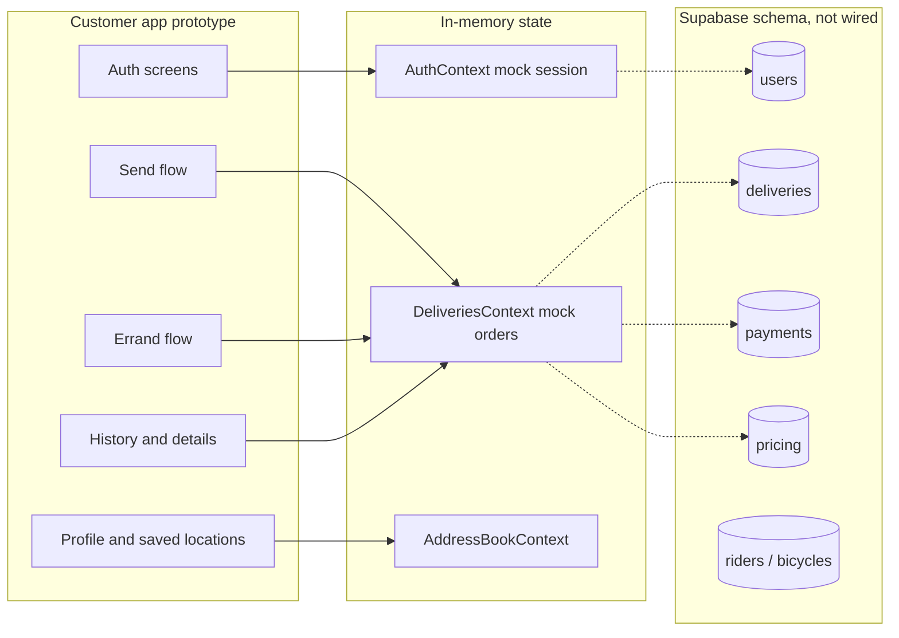
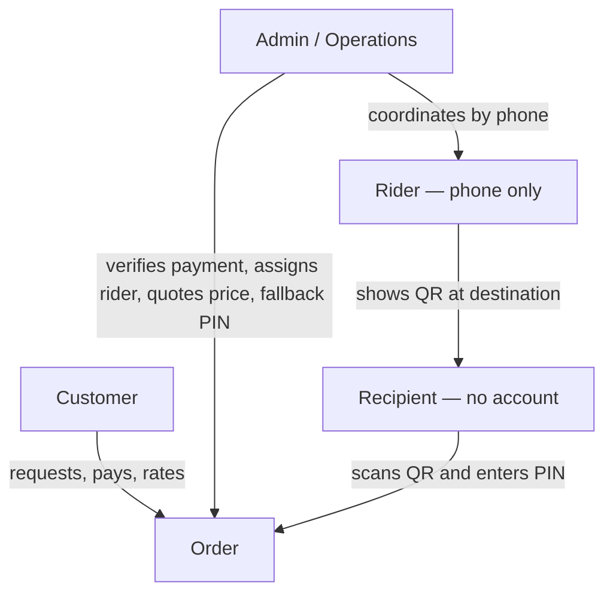
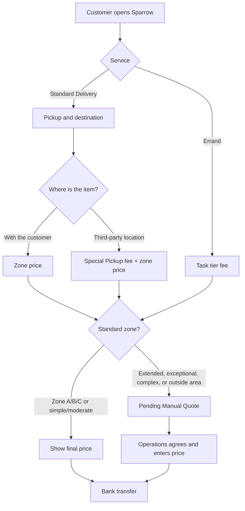
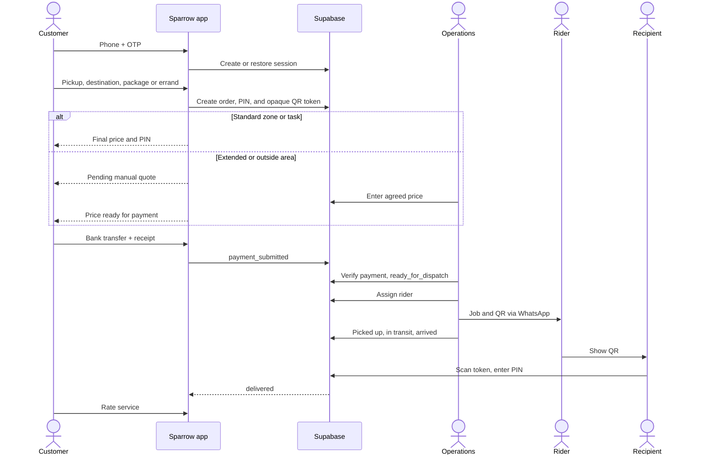
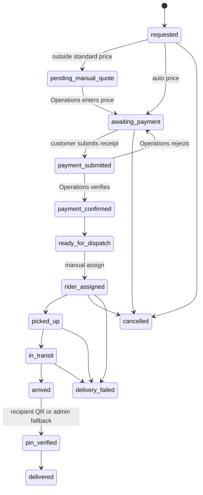
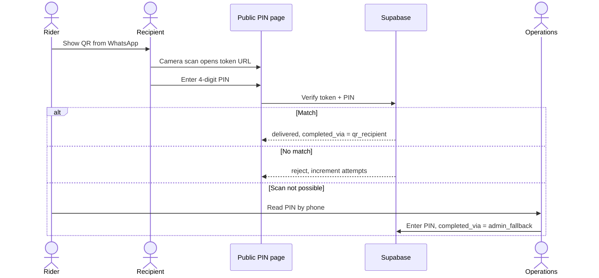
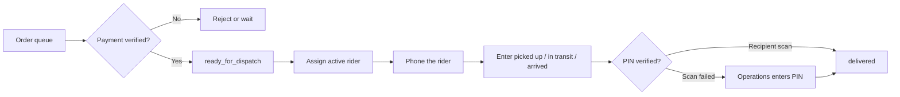

# Sparrow

**Product Requirements Document — Build Reference**
PRD V1.0 for the build
Local delivery, made simple.

| Document item | Value |
| --- | --- |
| Product | Sparrow |
| Document | Developer Reference PRD |
| Primary platform | React Native + Expo + Expo Router |
| Backend direction | Supabase / PostgreSQL |
| Operating model | Company-owned bicycles + controlled/employed riders + manual dispatch |

---

## 1. Executive Summary

Sparrow is a hyperlocal delivery service designed to make short-distance delivery dependable, visible, and easy to request within the Igbesa–Lusada–Ketu corridor. The product is not intended to launch as an open rider marketplace or a large logistics platform. The MVP is a controlled operating system: customers request services through a mobile app, payment is verified by operations, deliveries are manually assigned to controlled riders, and completion is secured with a delivery PIN and evidence where required.

The repository already contains a substantial mobile UI prototype covering authentication screens, delivery creation, errand flow, delivery history/details, profile and saved locations, plus a Supabase schema. The current application still relies on mock/in-memory state.

**Product principle:** technology should make the controlled operating model easier to execute. It should not replace operational discipline, except where a rule is decided or refined to fit MVP goals.

---

## 2. Product Goals

Simplicity and reusability.

- Enable a customer to request a standard delivery from pickup to destination in a few clear steps.
- Support Sparrow's three service types: Standard Delivery, Special Pickup, and Errand.
- Apply the approved zone/task pricing model without exposing complicated distance calculations to customers.
- Capture and verify payment before dispatch.
- Allow operations to manually assign a rider and monitor the delivery lifecycle.
- Give riders a simple operational workflow for assigned jobs. In V1 this workflow is phone coordination; Operations enters status updates on the rider's behalf. There is no rider login or rider app surface.
- Require a 4-digit delivery PIN before a delivery can be completed.
- Capture evidence and incidents when operationally necessary.
- Maintain reliable delivery/order records and customer history.
- Produce the operational data required to measure demand, reliability, and unit economics.

---

## 3. V1 Non-Goals

Open to refinement to fit build goals.

- Live GPS tracking.
- Rider bidding or an open gig marketplace.
- Public rider profiles.
- In-app wallet.
- Automated dispatch optimization.
- Business storefront/catalogue.
- Complex subscriptions or loyalty platform.
- AI/blockchain features.
- Multi-city expansion.
- Advanced route optimization.
- A dedicated rider app. Rider records exist for assignment tracking and KPI attribution only.

---

## 4. Current Product and Repository Baseline

The app, in `client-app/`, is an Expo + Expo Router + React Native + TypeScript project (`expo` 57, `react-native` 0.86). A Supabase client is configured in `client-app/lib/supabase.ts`, but authentication and deliveries are still mock/in-memory. The API is the Node.js service in `backend/`.

| Area | Current state | Assessment |
| --- | --- | --- |
| Mobile framework | Expo + Expo Router + React Native; TypeScript | Implemented foundation |
| UI / navigation | Customer tabs (Home, Deliveries, Profile), send flow (pickup → destination → package → summary → payment → confirmation), delivery details, profile, saved locations, errand request/confirmation | Strong prototype coverage |
| Authentication | Phone, OTP, and onboarding screens exist. `AuthContext` signs in a mock user (`mock-user-id`) with no Supabase session | Prototype; production auth not wired |
| Deliveries | `DeliveriesContext` creates in-memory deliveries from `client-app/lib/mockData.ts`, including client-side PIN and QR token generation | Prototype; Supabase persistence required |
| Payment | Bank-transfer UI exists; receipt interaction is mocked. New orders are stored as `payment_submitted` without a real payment record | Prototype; verification workflow required |
| Rider app | `client-app/app/(rider)` is a landing shell that redirects non-riders away | Early scaffold. Out of V1 scope — no rider login |
| Database | `supabase/migrations/20260902000123_create_sparrow_schema.sql` defines users, deliveries, riders, bicycles, payments, ratings, pricing, and notifications, with RLS | Good foundation; must be connected to the app |
| Pricing | `client-app/lib/pricing.ts` holds the approved Zone A/B/C, Special Pickup, and Errand fees. Phase 0 migration corrects the original seed (800/1200/1500) to 800/1000/1300 and adds special-pickup and errand pricing tables | Client and migration agree. The app still prices locally; it does not read the database |
| Admin operations | No admin route or operations surface | Operational capability still required |
| Domain types | `client-app/types/index.ts` already models service types, zone tiers, manual quote, QR token, PIN attempts, and completion source | Types are ahead of persistence |

Customer routes today:

| Route | Purpose |
| --- | --- |
| `/` | Gate: phone auth, then onboarding if name/community missing, else tabs |
| `/auth/phone`, `/auth/otp`, `/auth/onboarding` | Sign-in prototype |
| `/(tabs)`, `/(tabs)/deliveries`, `/(tabs)/profile` | Home, history, profile |
| `/send/pickup` → `destination` → `package` → `summary` → `payment` → `confirmation` | Standard delivery |
| `/errand/request`, `/errand/confirmation` | Errand request |
| `/delivery/[id]` | Delivery detail |
| `/saved-locations`, `/saved-locations-add`, `/profile-edit` | Address book and profile |

---

## 5. Critical Gap Analysis Before MVP Launch

| Gap | Why it matters | Priority |
| --- | --- | --- |
| Live Supabase integration | The app must persist real users, deliveries, payments, ratings, and notifications | P0 |
| Real OTP authentication | Business foundation requires phone + OTP authentication and a Supabase user identity | P0 |
| Payment verification | Dispatch must not occur from a client-side mock submission; operations must confirm payment | P0 |
| Manual dispatch capability | The operating model depends on controlled rider assignment | P0 |
| State-transition enforcement | Customers and riders must not be able to falsely mark deliveries complete | P0 |
| PIN verification | Delivery completion depends on the recipient PIN, verified server-side | P0 |
| Pricing from the database | Approved prices exist in `client-app/lib/pricing.ts` and the Phase 0 migration, but the running app does not read configured zones | P0 |
| Special Pickup data model | The business model charges separately for an additional collection movement. Phase 0 adds the columns; the app flow must persist them | P1 |
| Errand persistence | Errand UI exists, but it is not yet a complete persisted service workflow | P1 |
| Evidence upload | Photos are represented in the schema but need real storage and upload behavior | P1 |
| Notifications | The notification table exists, but event generation and delivery must be implemented | P1 |
| Admin reporting / KPIs | The business depends on operational KPIs that need reliable data and reporting | P1 |
| Operations interface | There is no admin product surface. V1 cannot launch on the customer app alone | P0 |

---

## 6. Users and Roles

| Role | Primary needs | Permissions |
| --- | --- | --- |
| Customer | Request delivery/errand, pay, track status, view history, receive updates, share the PIN with the recipient, rate the service | Own profile, own orders/payments/ratings. Create and cancel subject to state rules |
| Rider | No dedicated rider app screens in V1. Rider is coordinated by phone. Admin/Operations enters status updates on the rider's behalf. Delivery completion is primarily self-service via QR + PIN entered by the recipient; Admin enters the PIN only as a fallback | None in V1 (no rider login). A rider record exists for assignment tracking and KPI attribution only |
| Admin / Operations | Verify payments, assign riders, monitor active deliveries, handle exceptions, manage pricing/zones, review incidents and KPIs | Operational access across deliveries, payments, riders, bicycles, and configuration |
| Recipient | Scan the delivery QR and enter the PIN. No app install and no account | Public completion page scoped to one opaque QR token |

---

## 7. Service Model

| Service | Definition | V1 treatment |
| --- | --- | --- |
| Standard Delivery | Customer already has the item and wants Sparrow to move it from one pickup address to one destination | Base delivery service; pickup included |
| Special Pickup | Sparrow must make a separate collection from another third-party location before delivery | Additional pickup fee + standard delivery zone fee |
| Errand | Sparrow must perform an action such as buying an item or handling a straightforward task | Task fee + delivery where applicable; purchased goods are pass-through costs |

---

## 8. Sample V1 Pricing Architecture

Prices are the approved operating figures. Zone A/B/C, Special Pickup local/nearby, and Errand simple/moderate are automatic. Extended, exceptional, complex, and outside-service-area requests are manual quotes.

| Service component | Rule | Customer price |
| --- | --- | --- |
| Zone A — Local | Same community / short movement | ₦800 |
| Zone B — Nearby | Igbesa ↔ Lusada type movement | ₦1,000 |
| Zone C — Cross-zone | Longer Igbesa / Lusada / Ketu movement | ₦1,300 |
| Extended / exceptional | Longer approved local movement within Agbara Axis | ₦1,500+ |
| Outside service area | Not standard | Manual quote / unavailable |
| Special Pickup — Local | Separate nearby collection in the same community | +₦500 |
| Special Pickup — Nearby | Collection across a nearby community | +₦700 |
| Special Pickup — Extended | Longer approved pickup | +₦1,000+ |
| Errand — Simple | Straightforward purchase/task | ₦500 |
| Errand — Moderate | More coordination/handling | ₦700 |
| Errand — Complex | More involved | ₦1,000+ / manual quote |

Zone classification used by the prototype (`client-app/lib/pricing.ts`):

- Same community → Zone A.
- Igbesa ↔ Lusada → Zone B.
- Any movement touching Ketu → Zone C.
- Either side unresolved or outside these communities → outside service area, pending manual quote.

Special Pickup reuses that classification: A → local, B → nearby, C → extended (manual quote).

The original schema seed used ₦1,200 and ₦1,500 for cross-community routes. `supabase/migrations/20260907000001_phase0_service_types_and_pricing.sql` updates those rows to ₦1,000 and ₦1,300 and adds `special_pickup_pricing` and `errand_pricing`. Launch requires one source of truth: the database tables, read by the app, editable by Operations without a new build.

---

## 9. Customer Journey

1. Open Sparrow and authenticate with phone + OTP.
2. Choose Standard Delivery or Errand.
3. For Standard Delivery, enter pickup and destination information. Saved locations may be used.
4. Indicate whether the item is with the customer or at another location. If Sparrow must collect from a separate third party, apply Special Pickup.
5. Enter package/task details and any required photo/evidence.
6. The system determines the applicable zone/task pricing and displays the final amount. If the request falls outside standard zones (Extended/exceptional or outside service area), the order is created with status `pending_manual_quote` instead of an automatic price. Operations contacts the customer, agrees a price, and enters it into the order before payment can proceed. A delivery PIN and a delivery QR code are both generated immediately at order creation, regardless of pricing path. The PIN is shown to the customer on the confirmation screen with a prompt to share it with whoever will receive the package.
7. The customer pays by bank transfer, entering the order's reference code in the transfer narration, and submits payment confirmation/receipt.
8. The order remains unavailable for dispatch until operations verifies payment.
9. Operations assigns a controlled rider.
10. The customer receives status updates: Sparrow assigned → picked up → in transit → delivered.
11. At the destination, the rider shows the delivery QR code (received earlier from Operations via WhatsApp) to the recipient, who scans it with her own phone camera. This opens a lightweight web page (no app install required) prompting for the PIN. She enters it herself and the order is marked delivered on successful server-side verification. Fallback: if scanning is not possible, the rider reads the PIN to Operations by phone, who enters it manually to complete the delivery.
12. The customer rates the completed service.

### Order lifecycle

Customers can create an order and cancel only where state rules allow. They cannot mark a delivery complete. `delivered` is set only after server-side PIN verification.

### Completion

The QR encodes a random opaque token (`qr_token`), not the raw delivery id, so links cannot be guessed or enumerated. The PIN is generated server-side at order creation, is not user-editable, and is shown to the customer on the confirmation screen.

---

## 10. Functional Requirements

### 10.1 Authentication and account

| ID | Requirement | Priority | Acceptance |
| --- | --- | --- | --- |
| AUTH-01 | Customer can sign in/sign up with phone number and OTP | P0 | Valid OTP creates or restores an authenticated Supabase session |
| AUTH-02 | User profile stores name, phone, community, role, and account type | P0 | Profile persists in the `users` table |
| AUTH-03 | Role determines customer, rider, and admin experience | P0 | Unauthorized routes and actions are blocked. V1 exposes a customer app and an operations interface; rider role has no app surface |
| AUTH-04 | Session persists across app restarts | P0 | Authenticated user returns without re-entering OTP until the session expires |

### 10.2 Standard Delivery

| ID | Requirement | Priority | Acceptance |
| --- | --- | --- | --- |
| DEL-01 | Capture pickup address, landmark, and contact details | P0 | Required fields validated before continuation |
| DEL-02 | Capture destination address, landmark, and recipient details | P0 | Required fields validated |
| DEL-03 | Capture package category, size, and description | P0 | Only supported categories and sizes accepted |
| DEL-04 | Support optional package photo | P1 | Image is uploaded to secure storage and linked to the order |
| DEL-05 | Calculate approved zone price | P0 | Price is determined from configured operational zones, not client hardcoding |
| DEL-06 | Show final price before confirmation | P0 | Customer sees the service fee clearly before payment |
| DEL-07 | Generate unique delivery code | P0 | Each delivery receives a unique `SP-XXXX`-style code |
| DEL-08 | Generate delivery PIN and delivery QR code together | P0 | PIN and QR are created server-side at order creation, not deferred to rider assignment. PIN is not user-editable and is shown on the order confirmation screen. QR encodes a random opaque token, not the raw delivery id |

### 10.3 Payment, dispatch, and completion

These follow from the journey and the MVP definition of done.

| ID | Requirement | Priority | Acceptance |
| --- | --- | --- | --- |
| PAY-01 | Customer pays by bank transfer using the order reference in the narration and can attach a receipt | P0 | Order moves to `payment_submitted` and stays there until Operations acts |
| PAY-02 | Operations verifies or rejects the payment and records verifier and timestamp | P0 | Only a verified payment can move the order to `ready_for_dispatch` |
| DSP-01 | Operations assigns an active controlled rider | P0 | Assignment records rider, timestamp, and is visible to the customer |
| DSP-02 | Operations enters picked up, in transit, and arrived from the rider's phone confirmation | P0 | Status changes are audited and cannot be set by the customer |
| PIN-01 | Recipient completes delivery by scanning the QR and entering the PIN | P0 | Server verifies token and PIN before `delivered` |
| PIN-02 | Operations can enter the PIN as a fallback | P0 | Completion records `completed_via = admin_fallback` |
| RATE-01 | Customer can rate a completed order | P0 | Rating is stored against the delivered order and is not available before delivery |

### 10.4 Errand and Special Pickup

| ID | Requirement | Priority | Acceptance |
| --- | --- | --- | --- |
| SRV-01 | Special Pickup adds a separate collection fee on top of the zone fee | P1 | Order stores tier and fee; extended collection becomes a manual quote |
| SRV-02 | Errand persists category, tier, service fee, and pass-through item cost | P1 | Completed errand workflow is stored as a delivery record, not only UI state |
| SRV-03 | Extended, exceptional, complex, and outside-area requests are created as `pending_manual_quote` | P0 | Payment cannot proceed until Operations enters a confirmed price |

---

## 11. Operations / Admin Requirements

The controlled business model makes operations a first-class product actor. A customer-facing mobile app alone is insufficient for launch. V1 requires at least a secure internal operations interface, even if the first implementation is intentionally simple.

| Capability | Minimum V1 requirement |
| --- | --- |
| Order queue | View and filter orders by payment status and delivery status |
| Payment verification | Open payment record/receipt, verify or reject, record verifier and timestamp |
| Manual dispatch | Select an active rider and assign the delivery. Enter status updates (picked up, in transit, arrived) on the rider's behalf, based on the rider's phone confirmation. There is no rider app in V1. Delivered is normally set by the recipient's own QR/PIN scan. Operations enters the PIN manually only as a fallback |
| Active delivery monitoring | See assigned rider, current status, key timestamps, and exceptions |
| Exception handling | Cancel, fail, reassign, or manually intervene with an audit trail |
| Pricing management | Manage active zone/task pricing without shipping a new app build. Set a confirmed price on Pending Manual Quote orders (Extended/exceptional or outside-service-area requests) before they can proceed to payment |
| Rider management | Activate/deactivate riders and associate bicycles |
| Fleet management | Track bicycle availability, condition, maintenance, and assignment |
| Incident logging | Record delivery, rider, customer, or asset incidents |
| KPI reporting | Daily deliveries, realized revenue/order, contribution/order, rider productivity, repeat rate, on-time completion, cancellation/failure, payment verification time, incidents, and bicycle downtime |

---

## 12. Non-Functional Requirements

| Area | Requirement |
| --- | --- |
| Performance | Primary screens should feel responsive on typical mid-range Android devices and unstable/slow mobile networks |
| Reliability | Order and payment state must be durable and recoverable after app restart or network interruption |
| Offline tolerance | Status updates entered by Operations should handle temporary connectivity loss and avoid duplicate submissions. V1 has no rider app, so this applies to the operations interface, not a rider client |
| Security | RLS, role checks, protected functions, secure storage, and environment secrets are mandatory. Critical transitions (payment confirmation, rider assignment, PIN verification, delivery completion) must not be writable by the customer client |
| Observability | Errors, failed state transitions, payment verification failures, and delivery exceptions should be logged |
| Accessibility | Readable text, clear contrast, large touch targets, and understandable status labels |
| Maintainability | Business pricing and zone rules should be configurable rather than scattered across screens |
| Scalability | Architecture should support additional riders, bicycles, and communities without redesigning core entities |

---

## 13. MVP Definition of Done

- A new customer can authenticate with a real phone/OTP flow.
- A customer can create a Standard Delivery end-to-end using real data.
- The system applies the approved zone pricing and displays the final price before payment.
- A customer can submit payment confirmation and optionally attach a receipt.
- Operations can verify the payment and only then move the order to `ready_for_dispatch`.
- Operations can manually assign a controlled rider.
- The recipient PIN is verified server-side before delivery completion.
- Delivery evidence can be captured where required.
- The customer receives meaningful status updates.
- The customer can view delivery history and rate a completed order.
- Operations can see the minimum KPIs required to evaluate the first 90 days.
- No production secrets, mock user identity, or mock delivery persistence remain in the launch path.
- Pricing in the app, database, and business operating document is reconciled to one approved source of truth.

---

## 14. Build Notes From the Current Repo

These are constraints for the next implementation pass, taken from the code as it stands.

- Replace `AuthContext` mock sign-in with Supabase phone OTP. `client-app/lib/supabase.ts` already expects `EXPO_PUBLIC_SUPABASE_URL` and `EXPO_PUBLIC_SUPABASE_ANON_KEY`.
- Replace `DeliveriesContext` in-memory creates with inserts into `deliveries`. Stop generating PIN, QR token, and `SP-` codes on the client; the schema already has `generate_delivery_pin()`, `generate_qr_token()`, and `generate_delivery_code()`.
- Read prices from `pricing`, `special_pickup_pricing`, and `errand_pricing`. Keep `client-app/lib/pricing.ts` as a classifier (which zone), not as the price list.
- Do not build out `client-app/app/(rider)` for V1. Rider coordination stays on the phone; the rider row is for assignment and KPIs.
- Add an operations surface for payment verification, manual quote, dispatch, status entry, fallback PIN, and the KPI set in section 11.
- Customer RLS in the current migration allows customers to update their own delivery rows. Launch must move payment confirmation, assignment, and completion behind protected functions so a client cannot mark an order delivered.
